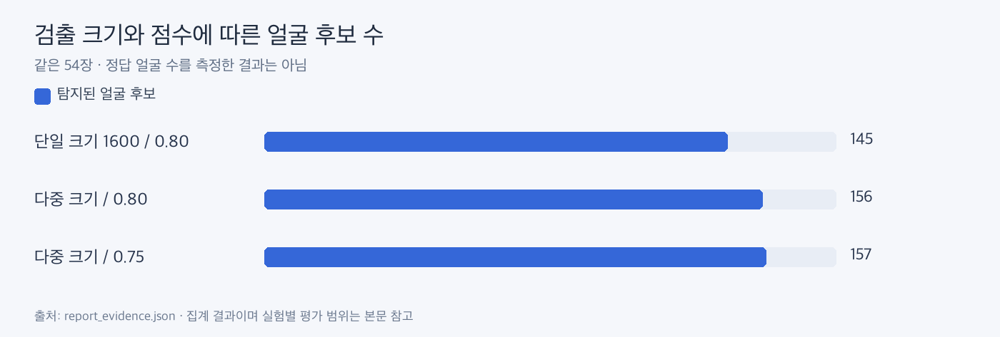

# 검출 설정 비교

**다중 크기로 작은 얼굴 후보를 더 찾았고, 현재는 0.75를 사용합니다.**

| ljm_dataset 54장 | 얼굴 후보 | 얼굴 없는 사진 |
|---|---:|---:|
| 단일 크기 1600 / 0.80 | 145 | 3 |
| 다중 크기 / 0.80 | 156 | 1 |
| 다중 크기 / 0.75 | 157 | 1 |

다중 크기는 긴 변 960·1600·2400입니다. 낮은 점수는 실제 얼굴과 오검출 모두를 늘릴 수 있어 후보 수 증가를 정확도 향상으로 단정하지 않습니다.

ljm2_dataset 27장에서는 0.75가 84얼굴, 0.80이 80얼굴이었습니다. 0.80에서 단체 사진 2장이 ‘2명 사진’으로 이동했습니다. 현재 실행에는 0.8 선택 옵션이 없습니다.

근거: [집계 원본](report_evidence.json)의 detection, albums. 과거 PC 전체 처리 시간은 다중 크기 0.75 약 21.2초였으며 모바일 속도는 아닙니다.
