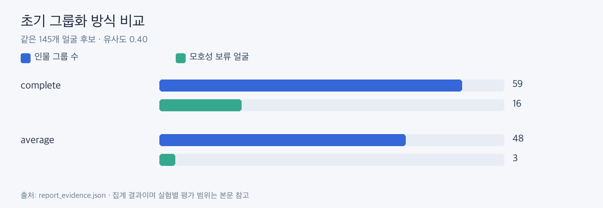

# 인물 그룹화 비교

**average가 complete보다 덜 잘게 나뉘었고, 현재 인물 판정은 average 0.40입니다.**

| 같은 145얼굴 후보 | 그룹 | 모호성 보류 |
|---|---:|---:|
| complete 0.40 | 59 | 16 |
| average 0.40 | 48 | 3 |
| complete 0.35 | 51 | 21 |
| complete 0.45 | 66 | 18 |

위 수치는 정답 평가가 아닙니다. 별도 156얼굴 실험에서 수동 오검출 3개를 제외하고 average를 0.36/0.38/0.40으로 바꾸면 그룹은 39/46/48개였습니다. 수동 제외가 있으므로 첫 표와 직접 정확도를 비교하지 않습니다.

average는 그룹 사이 평균 거리로 병합합니다. 같은 그룹의 모든 얼굴 쌍이 0.40 이상이라는 뜻은 아닙니다. 현재는 1명 사진 안에서, 2명 사진 안에서 따로 인물을 판정합니다.

근거: [집계 원본](report_evidence.json)의 grouping. 초기 단일 크기 실행과 평균 방식 재실행은 동일 후보 비교용 기록이며 현재 사진 앨범 개수와는 다릅니다.
