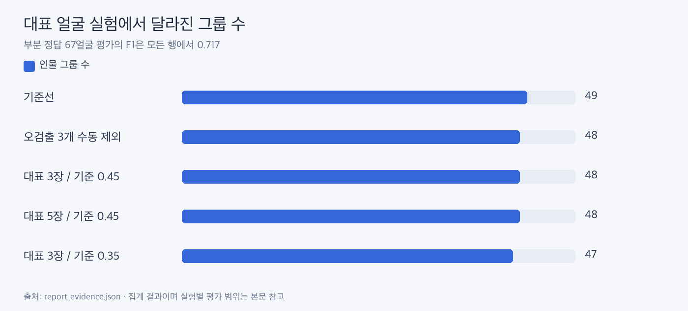

# 오검출 보정과 대표 얼굴 실험

**대표 수를 늘려도 이번 부분 정답 평가에서는 개선이 확인되지 않았습니다. 현재 앱 경로에는 추가하지 않았습니다.**

| 실험 | 인물 그룹 | 미확인 | F1 |
|---|---:|---:|---:|
| 기준선 | 49 | 7 | 0.717 |
| 오검출 3개 수동 제외 | 48 | 5 | 0.717 |
| 대표 3장 / 평균 기준 0.45 | 48 | 5 | 0.717 |
| 대표 5장 / 평균 기준 0.45 | 48 | 5 | 0.717 |
| 대표 3장 / 평균 기준 0.35 병합 | 47 | 5 | 0.717 |

정답이 있는 67얼굴만 평가했습니다. 평균 기준 0.40·0.45도 평가 지표가 같았습니다. 미확인 감소에는 사람이 오검출을 제외한 효과가 포함되어 있습니다. 수동 그룹 보정과 단독 얼굴 검토도 사용자 수정 기능 실험이며 자동 성능 개선으로 계산하지 않습니다.

별도의 자동 대표 실험은 대표를 자동 선정했지만 ljm_dataset과 ljm2_dataset 모두 재배정·작은 그룹 연결 승인 0건이었습니다. 해당 기준에서는 연결을 보수적으로 보류한 결과입니다.

근거: [집계 원본](report_evidence.json)의 representatives, automatic_anchors. 3장·5장 비교와 평균 기준 실험은 같은 부분 정답을 사용한 탐색적 결과입니다.
