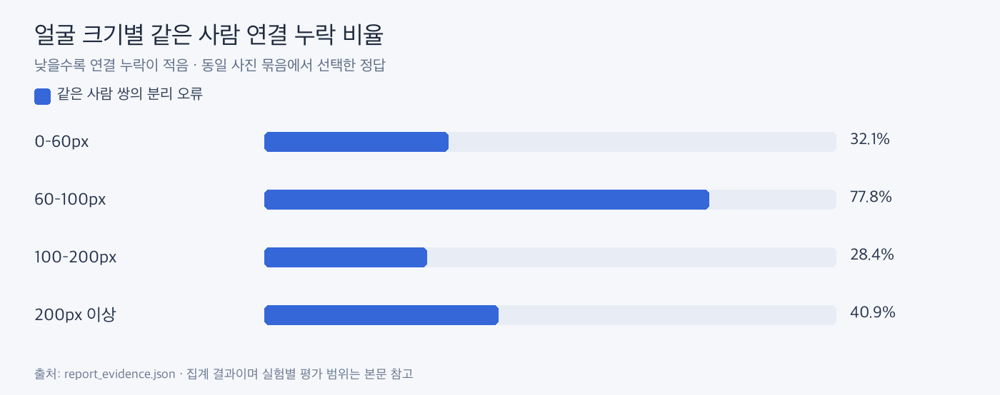

# 얼굴 품질과 병합·분리 진단

**얼굴 크기만으로 인식 성공을 설명할 수 없어, 품질 제외와 애매한 사진 보류를 유지합니다.**

| 얼굴 크기 | 정답 얼굴 수 | 같은 사람 쌍 분리 오류율 |
|---|---:|---:|
| 60px 미만 | 6 | 32.1% |
| 60~100px | 11 | 77.8% |
| 100~200px | 47 | 28.4% |
| 200px 이상 | 89 | 40.9% |

153얼굴의 선택된 정답을 사용했습니다. 오류율은 얼굴 쌍에서 더 작은 얼굴의 크기로 구간을 정하며, 정답 얼굴 수 열은 개별 얼굴 기준입니다. 오류율을 단순 평균하면 안 됩니다. 작은 구간은 표본이 적고 자세·가림·표정도 달라 일반적인 성능 곡선으로 해석하지 않습니다.

그룹 병합·분리 진단에서는 48그룹 중 혼합 그룹 2개가 확인됐습니다. 탐색적 평가 분할 44얼굴에서 병합 전/후 F1은 0.573/0.821이었지만 같은 사진 모음에서 선택한 규칙의 결과라 독립 성능 근거가 아닙니다. 현재 자동 병합 기능에는 적용하지 않았습니다.

근거: [집계 원본](report_evidence.json)의 quality, merge. 이전 부분 정답 67·80얼굴 진단과 사용자 쌍 검토도 있었으며 위 표는 153얼굴로 확장한 결과입니다.
