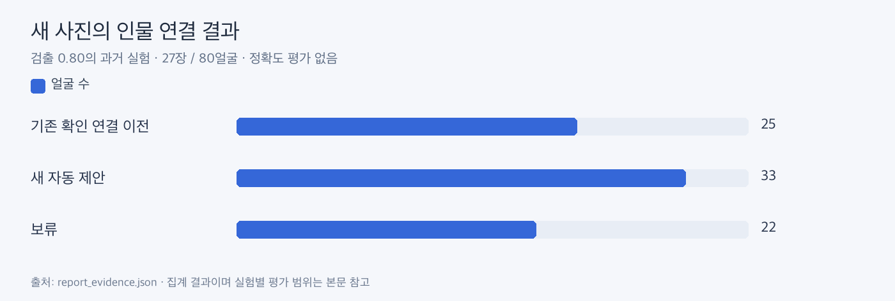

# 영구 인물 ID와 새 사진 연결

**자동 그룹 번호와 사용자 인물 ID를 분리하는 기능을 시험했습니다. 현재 사진 앨범 분류와는 별도 실험입니다.**

| ljm2_dataset, 검출 0.80 | 얼굴 수 |
|---|---:|
| 동일 사진에서 기존 확인을 이전 | 25 |
| 새 자동 연결 제안 | 33 |
| 보류 | 22 |
| 합계 | 80 |

27장 중 동일 내용 사진 6장·새 내용 사진 21장이었습니다. 새 사진 정답이 없어 Precision·Recall·F1은 계산하지 않았습니다. 자동 제안은 사용자 확정과 구분했습니다.

이전 동일 사진 모음 실험에서는 확인한 얼굴 65개·인물 23명을 기준으로 ID 연결·변경·되돌리기와 제안을 시험했습니다. 이름과 사용자 수정은 영구 ID로 보관해야 한다는 설계 참고이며, 현재 앱의 영구 DB가 완성됐다는 의미는 아닙니다.

근거: [집계 원본](report_evidence.json)의 identity. 원래 0.80 실험을 기록한 것이며 현재 설정은 0.75입니다.
