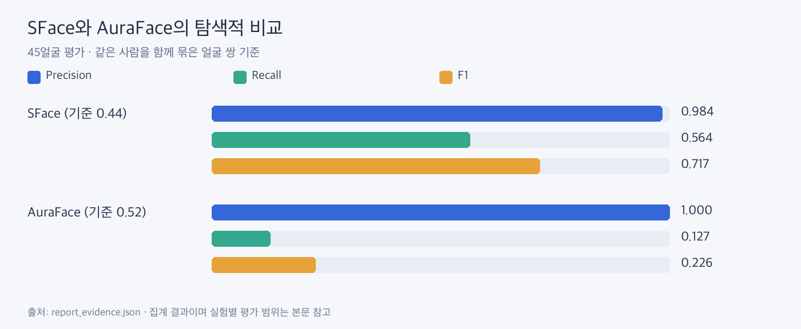
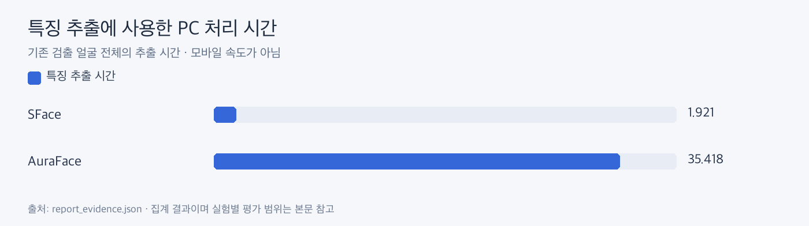

# SFace와 AuraFace 비교

**이번 데이터에서는 SFace가 같은 사람을 더 많이 연결했고 빨랐습니다. 현재는 SFace를 사용합니다.**

| 모델 | 차원 | 선택 기준 | Precision | Recall | F1 |
|---|---:|---:|---:|---:|---:|
| SFace | 128 | 0.44 | 0.984 | 0.564 | 0.717 |
| AuraFace-v1 | 512 | 0.52 | 1.000 | 0.127 | 0.226 |

전체 특징 추출 시간은 SFace 1.92초, AuraFace 35.42초였습니다. 위 지표는 평가 분할의 정답 얼굴 45개, 시간은 전체 검출 후보의 PC 추출 기준이라 범위가 다릅니다.

기존 검출 0.80 결과를 고정한 비교입니다. 이미 확인한 사진을 탐색적으로 나눴으므로 독립 테스트가 아니며 미검출 성능도 평가하지 않았습니다. 두 모델의 같은 숫자 0.40 비교는 같은 오인식 수준을 의미하지 않아 모델별 선택 기준 결과를 제시했습니다.

근거: [집계 원본](report_evidence.json)의 models, model_timing. 모델 교체 실험은 종료했고 AuraFace 실행 코드는 제거했습니다.
