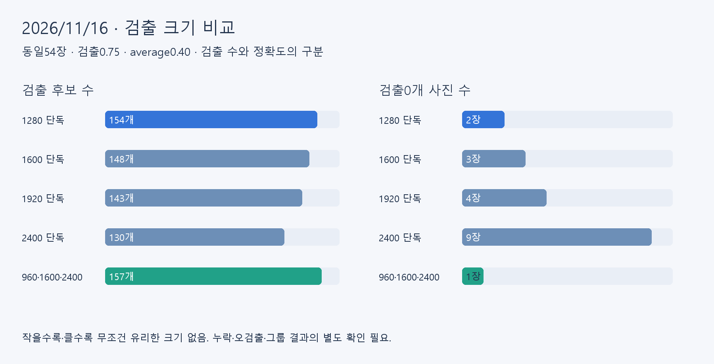
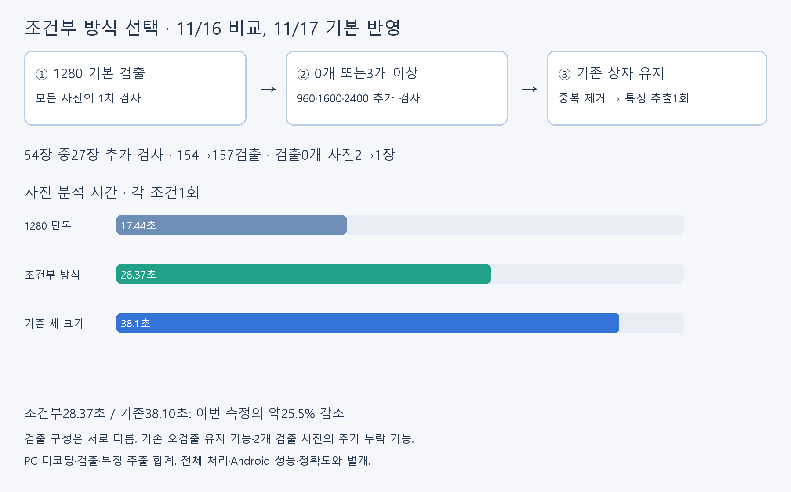
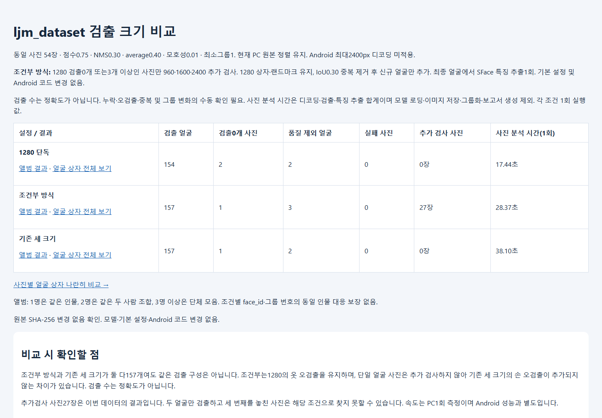

# 2026/11/16 검출 크기·조건부 방식 비교

비교일11/16, 기본 코드 반영·재검증11/17(한국 시간). ljm_dataset54장·CPU1스레드·점수0.75·NMS0.30·average0.40·모호성0.01·최소그룹1. 원본 정렬 유지 및 검출 크기/실행 조건만 변경. **검출 수는 정확도와 별개.**

## 1. 크기 비교 결과

1600·2400·기존 세 크기 실행 후1280·1920 추가 비교. 크기별 결과 HTML 생성 및 입력 SHA 동일 확인.

| 크기 | 검출 후보 | 검출0개 사진 |
|---|---:|---:|
| 1280 단독 | 154 | 2 |
| 1600 단독 | 148 | 3 |
| 1920 단독 | 143 | 4 |
| 2400 단독 | 130 | 9 |
| 960·1600·2400 | 157 | 1 |

1280의154개와 세 크기의157개는 순차이3개. IoU≥0.5 일대일 상자 대응153개, 세 크기만4개·1280만1개. IoU0.3에서도 같은 집계. 차이 영역만의 육안 검토: 세 크기의 얼굴로 보이는3개(작은 배경·큰 앞쪽·근접 얼굴)와 손 오검출1개, 1280의 옷 오검출1개. 작은 배경 얼굴의 품질 제외 및 추가 수동 확인 필요. 전체153개 정답·정체성 정확도 미평가.

## 2. 조건부 방식 비교 결과

세 조건의 새 분석 및 별도 HTML 생성. **기본1280 → 검출0개 또는3개 이상일 때만960·1600·2400 추가 → 기존1280 상자·점수·랜드마크 유지 → IoU0.30 중복 제거 → 최종 얼굴의 특징 추출1회.**

| 방식 | 검출 후보 | 검출0개 사진 | 추가검사 사진 | 사진 분석 시간 |
|---|---:|---:|---:|---:|
| 1280 단독 | 154 | 2 | 0 | 17.44초 |
| 조건부 방식 | 157 | 1 | 27 | 28.37초 |
| 기존 세 크기 | 157 | 1 | 0 | 38.10초 |

조건부 추가검사27장·추가검출3개. 이번 사진 분석 시간의 약25.5% 감소. 시간 범위는 디코딩·검출·특징 추출이며 저장·그룹화·보고서 생성 제외. 각 조건1회 실행으로 반복 벤치마크·Android 성능과 구분. 조건부·세 크기는 둘 다157개이나 검출 구성 상이. 조건부의 옷 오검출 유지 및 세 크기의 손 오검출 미추가. 품질 제외 얼굴은1280 2개 / 조건부3개 / 세 크기2개.

## 3. 기본 반영·확인 결과

- `engine.py`·`detection.py`의 조건부 기본 적용, 새 설정 `configs/selected_conditional.json` 기록. 이전 다중 크기 기록의 과거 상태 표시.
- 기존 `python -m face_lab albums --input "사진 폴더"` 명령의 새 정책 적용. `extract`도 동일 정책 적용. 프로그램에서 단독/기존 다중 크기 비교 시 `Settings(conditional_detection=False, detection_sides=(...))` 명시.
- `photos.json`의 사진별 조건·실제 입력 크기·추가검출 수, `summary.json`의 실제 설정·정책 버전·재검사 집계 기록. 프로젝트1.1.0·전처리v2 구분.
- Python20검사·사진 앨범 JS검사 통과. 검출0/1/2/3 경계·기존 상자/랜드마크 보존·중복 추가 방지·최종 얼굴별 특징 추출1회·손상 사진 격리 확인.
- 설치된 기본 코드로54장 재분석:157검출·검출0개1장·실패0장·재검사27장·추가3개. 앞선 조건부 실험과 전체 얼굴 기록 일치, 특징 벡터 오차1e-6 이내 일치. 분석 네트워크 차단·원본 해시 보존 확인.
- 모델 가중치·원본·수동 기록 보존. Android 코드 미변경. 기기 디코딩·좌표·버전 전환·재분석·메모리·속도·품질의 별도 검증 필요.

현재 자료를 보고 선택한 조건. 2개 얼굴을 찾은 사진의 세 번째 얼굴 누락, 기존 오검출, 다른 데이터의 품질 보장 불가. 새 자료의 독립 확인 필요.

## 4. 근거와 이미지 보관

[수치·모델·버전·출처 SHA](20261116_evidence.json). 위 차트와 요약 화면은 개인 사진 미포함 공유 자료. [차이5영역 확대·실제 사진 비교 화면](private_20261116/index.html)은 개인 사진 포함 로컬 보존 자료이며 Git 제외. clone 환경에는 해당 자료 없음.

[세 방식 결과 요약(로컬)](../../results/conditional_comparison_20261116T141921_565436Z/README.md) · [기본 적용 결과 요약(로컬)](../../results/conditional_default_implementation_20261117/README.md). 2026/11/17 최상위 results 실행 결과의 대표 이미지1장·3줄 요약 정리, 원시 HTML·복사 사진·벡터·JSON 삭제. 이 문서의 차트·집계·확대 검토 이미지와 Word 보관 자료 유지. 근거 JSON의 source·output 경로와 SHA는 당시 원시 기록이며 현재 파일 링크와 구분.
