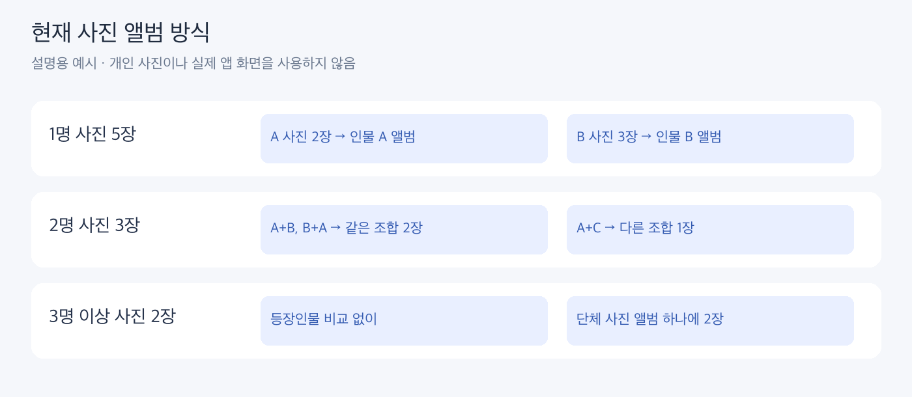

# 테스트 결과 모음

[private에서 진행한 테스트 변경 이력 한눈에 보기](private_test_history.md)

현재 적용: **YuNet 다중 크기 + 검출 0.75 + SFace**, 1명은 인물별·2명은 조합별·3명 이상은 단체 사진 모음입니다.

| 무엇을 확인했나 | 결과 문서 | 현재 반영 |
|---|---|---|
| 크기·검출 점수 | [검출 설정](01_detection.md) | 다중 크기 0.75 |
| complete/average·유사도 | [그룹화](02_grouping.md) | average 0.40 |
| 오검출 보정·대표 3/5장·자동 대표 | [대표 얼굴](03_representatives.md) | 과거 실험만 보관 |
| 얼굴 크기·그룹 병합/분리 | [품질 진단](04_quality_merge.md) | 품질 제외만 유지 |
| 영구 인물 연결·새 사진 | [인물 ID](05_identity.md) | 앱 구현 참고 |
| SFace와 AuraFace | [모델 비교](06_models.md) | SFace |
| 현재 사진 단위 앨범 | [사진 앨범 결과](photo_count_comparison.md) | 적용 완료 |
| 핵심 코드 분리·범용 입력 | [검증 기록](reorganization_validation.md) | 적용 완료 |

개수는 정확도가 아닙니다. Precision은 묶은 쌍이 맞는 비율, Recall은 같은 사람 쌍을 찾아 묶은 비율, F1은 두 지표의 균형입니다. 얼굴 쌍 기준 지표이며 사진 검색 정확도가 아닙니다.

차트 수치와 당시 원본 파일의 SHA-256은 [report_evidence.json](report_evidence.json), 과거 전체 실행 집계는 [experiment_summaries.json](experiment_summaries.json)에 있습니다. tests/private/의 원본 개인 결과·벡터·웹 결과는 사용자 확인 후 삭제했습니다. JSON의 source 경로와 해시는 당시 근거 기록이며 현재 파일 링크가 아닙니다. 설명 그림은 실제 개인 사진이나 앱 화면이 아닙니다.

자기 사진 실행: `python -m face_lab albums --input "사진 폴더"`. 과거 실험 실행 코드는 정리했고 현재 기능의 자동 검증만 tests/에 남겼습니다.
