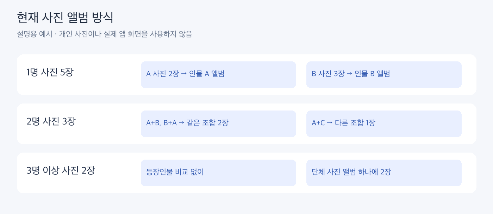
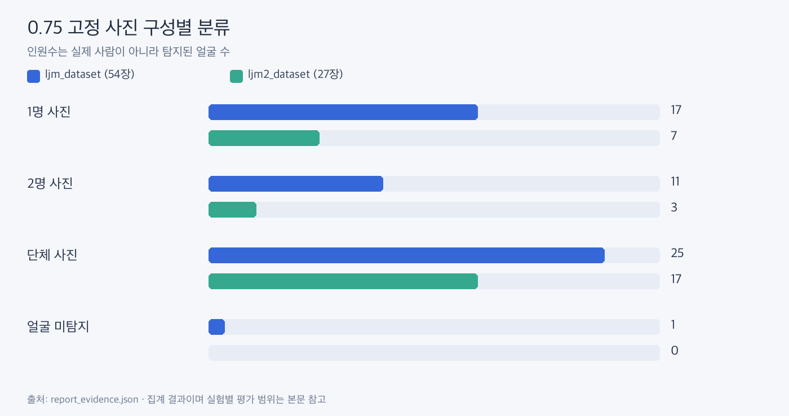

# 현재 사진 앨범 결과

**1명은 같은 인물끼리, 2명은 같은 두 사람 조합끼리, 3명 이상은 단체 사진 하나로 묶습니다.**





| 0.75 고정 | ljm_dataset | ljm2_dataset |
|---|---:|---:|
| 전체 사진 / 탐지 얼굴 | 54장 / 157개 | 27장 / 84개 |
| 1명 사진 → 인물 앨범 | 17장 → 8개 | 7장 → 3개 |
| 2명 사진 → 조합 앨범 | 11장 중 9장 → 7개 | 3장 중 2장 → 2개 |
| 2명 사진 확인 필요 | 2장 | 1장 |
| 단체 사진 → 모음 | 25장 → 1개 | 17장 → 1개 |
| 얼굴 미탐지 | 1장 | 0장 |

2명 사진의 A+B와 B+A는 같은 조합입니다. 하나라도 품질 제외·보류이거나 두 얼굴이 같은 인물 그룹이면 사진 전체를 확인 필요로 둡니다. 단체 사진은 인물별 군집을 실행하지 않습니다. 인원수는 탐지 얼굴 수라 실제 사람 수와 다를 수 있습니다.

초기에는 모든 얼굴을 인물별로 묶거나 1/2/3명 사진에서 각각 얼굴을 묶어 비교했습니다. ljm_dataset의 통합 얼굴 그룹은 49개, 세 분리 결과 합은 62개였지만 사진 앨범 목적과 달라 현재 방식으로 변경했습니다. 이 그룹 수를 위 사진 앨범 수와 비교하면 안 됩니다.

ljm2_dataset의 과거 0.80 실험은 80얼굴·2명 사진 5장·단체 사진 15장이었습니다. 현재 실행은 0.75 고정입니다. 사진 수와 앨범 수는 정확도 지표가 아닙니다.

## 자기 사진으로 실행

```sh
python -m face_lab albums --input "내 사진 폴더"
```

하위 폴더까지 새로 분석하고 마지막 Result의 index.html을 브라우저로 엽니다. --output으로 결과 위치를 바꿀 수 있습니다. JPG/PNG/BMP/WebP/TIFF 지원, HEIC는 변환 후 사용합니다. 설치는 [루트 README](../../README.md)를 참고하세요.

웹에서 사진 썸네일·검색·정렬·확인 필요 필터·원본 얼굴 위치를 확인합니다. 과거 실험 명령과 tests/private/의 원본 개인 결과는 삭제했습니다. 위 명령으로 입력 사진에서 새 결과를 생성할 수 있습니다.

근거: [집계 원본](report_evidence.json)의 albums. ljm2_dataset은 범용 입력 경로로 27장을 재분석해 동일한 결과를 확인했습니다.
